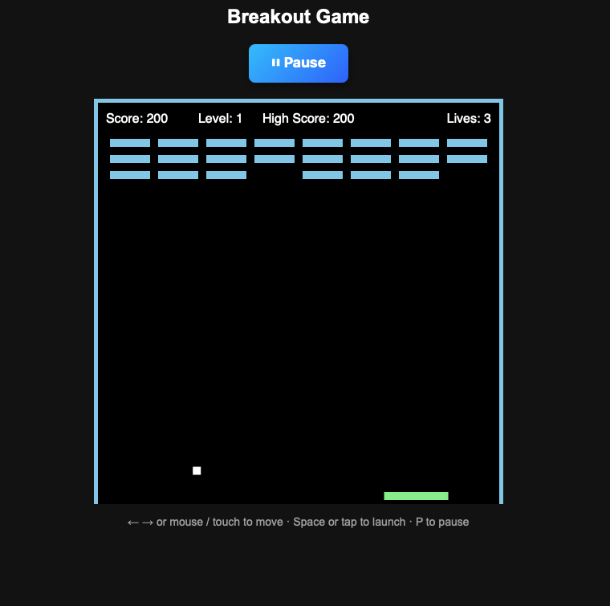

# 🧱 Breakout Game — JavaScript Canvas

A modern take on the classic Breakout arcade game, built with HTML5 Canvas, CSS and vanilla JavaScript.
It demonstrates object-oriented programming, a real-time game loop, collision detection and keyboard, mouse and touch controls.

🎮 **[Play the game](https://breakout-game-indol.vercel.app/)**



## 🎮 Features

- Paddle controlled with the keyboard, the mouse or your finger
- Ball physics: the bounce angle depends on where the ball hits the paddle
- Brick breaking, score and **high score saved in the browser** (`localStorage`)
- Lives system and a **launch step** after each lost life
- **Progressive levels**: one more row of bricks and a faster ball each time
- Pause / resume
- Sound effects
- Game over screen with quick restart

## 🛠 Technologies

- HTML5 Canvas
- CSS3
- JavaScript (ES6 classes)
- `requestAnimationFrame` game loop with a capped delta time

## 🎯 Controls

| Action | Keyboard | Mouse / touch |
|---|---|---|
| Move the paddle | ← / → | Move the pointer or drag |
| Launch the ball | Space | Click or tap |
| Pause / resume | P or the Pause button | Pause button |
| Restart after Game Over | Space | Click or tap |

## 🚀 Run it locally

```bash
git clone https://github.com/Yelle-stack/breakout-game.git
cd breakout-game
```

Then open `index.html` in your browser. No installation or build step needed.

## 📁 Project structure

```
├── index.html
├── breakout.css
├── breakout.js      # Player, Ball, Block and Game classes
└── sounds/
    ├── bounce.mp3
    └── gameover.mp3
```

## 🔮 Future improvements

- Power-ups and special bricks
- Different brick colors and patterns per level
- Mute button
- Online leaderboard

## 👩🏻‍💻 Author

**Jelena Zeko** – Full-Stack Developer
GitHub: [@Yelle-stack](https://github.com/Yelle-stack)
